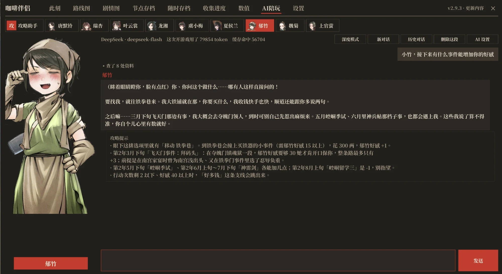
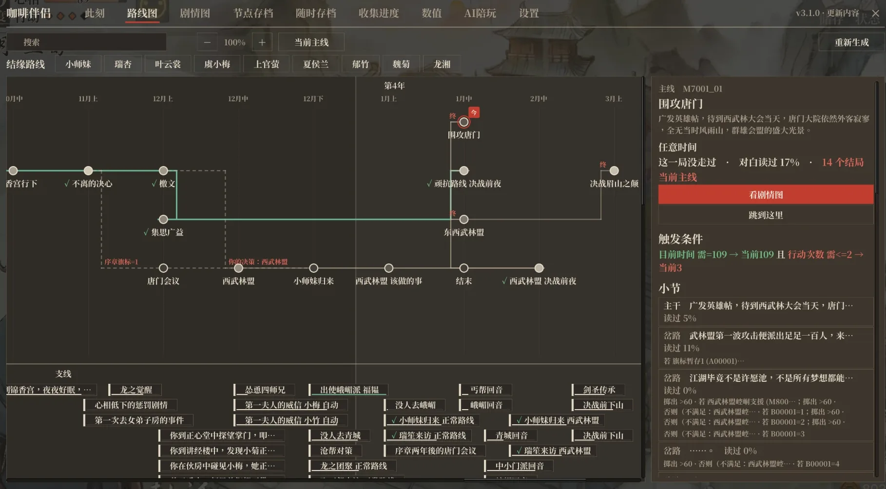
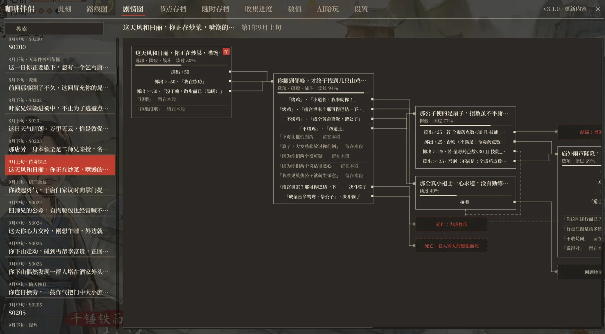

# 珈琲のおとも

[简体中文](README.md) · [繁體中文](README.zh-Hant.md) · [English](README.en.md) · **日本語** · [한국어](README.ko.md)

『活俠傳』（Legend of Mortal）用の BepInEx 6 プラグインです。名前の「咖啡伴侣」（コーヒーのおとも）は、プレイヤーが瑞杏につけたあだ名「咖啡」（コーヒー）から来ています。瑞杏の中国語読みが中国のコーヒーチェーン「瑞幸（Luckin Coffee）」と同じだからです。最新版のゲームに対応し、AIお供、ストーリーの全体像、分岐の選択、数値エディタ、セーブの改良などを追加します。

[日本語化MOD](https://dlaqe2334.github.io/LOM-JPMOD/)を導入している場合、このMODのウィンドウやメッセージは自動的に日本語で表示されます（設定タブ上部の「表示言語」でも切り替え可能）。現在はよく使う画面の文字だけを翻訳しており、それ以外は中国語のままです。翻訳は正確でない場合があります。おかしな訳を見つけたら [Issues](https://github.com/kevinnie2003/LOMAssistant/issues) で教えてください。以下のスクリーンショットは中国語版です。

 [![Nexus Mods](https://img.shields.io/badge/Nexus%20Mods-%E3%83%80%E3%82%A6%E3%83%B3%E3%83%AD%E3%83%BC%E3%83%89-D98F40?style=for-the-badge&labelColor=8A5A28&logo=data%3Aimage%2Fpng%3Bbase64%2CiVBORw0KGgoAAAANSUhEUgAAACAAAAAgCAYAAABzenr0AAAEXElEQVR4AazW7XkTOxAF4E0auaYSQiVAJQmVECrBVEJuJeG8Y42stR3yBz%2BalTQfZ45GWq3vt3%2F8e319PUQeI7%2BH%2FEz%2F8FaamwQSAOQh%2FVUgXUSC7%2BmBt5g%2FJtHvyFPkMARG%2B9BFfW47AgGU%2BGfMQPQCrUQvwWts9BJ8yRh4izl91LO9zNG28YNz2JbfJCB59BJzzHA2AXQSTOU7g6e70%2B9D%2FL5GmggsJOBFvW2TQGbfI90EHDN5jujTVWu9lX6KZhU69k%2FJ%2FS22ahnD4KenQ2LmKgJZPUWzKhCeCcaeCJYAEEKqYStWYf%2BaGHbhU6KDiRQceltd%2Be6T3AAgAwEi4GXYJBHMZosksgrzVcRdJQ%2BGZBYIZ42rsQp8XlBWEEkFqkAnXlx3w2NW2aubhiS3OIm32J2HH9M4BghwqmmcJkjGqmBeAOXw9gPZnXVJXrYx%2F7g4VbUQaJ2EPa4%2BJAQrec1vPBBcq1YuI1kTdzdYuWrOrQ525UOgBom0V9Mh82pxRMI21DwPSdNVO8S%2BzkuZh6Tpqtlr2wynFHnU6tPXa7ga3HAC2KaMJPYQkdX%2Fynesfm7rALlc2Iy7Dzg2vQqGLt2IPXXxe4k8R1Rs%2Bo%2BEJ6c8Y4fndc1s1%2F7LjC3dptpyVQUofnkMOQbU9Xu5imGuzp7WII86WIkBqoJ9Xce0a6pwVT1ngFeBGESAY%2BfuJ8ZRn9tYZa%2FmS5Kr2nuv6iVO5WwCZ%2FRtU%2BItPwFYu7v1UW1bktVKa3J68FurJR65v709IsXNLaBoKUNP0tc8iZXXKgnwy6R0vgMfUqFbZyBQu4boJFCTxWwFy3TzDktQZIZhF5Ok3yIzLmP77c2ZusSt8f9nPgnUhOIdkXT91Da4bVkrUjAh4c1RDeTFehPK1o8%2BA4yte8yggTOcTWLltbJWOrA9dtn0eNeHiBhE5lmKw%2FkQxkHCJqFMK3B8qz3lHLDVZDzEjeFWFYjPmmTrX3LAR6JV9ZevK9BKvSSqoGzmLb54QHruC2feJGyDOK%2FuzXtkkHCbwpDn80qAgqHF5dTgEnVg272SVts%2B9E0aFiII0a%2By%2Bj8UgYuyuWbtmZPfSX3xkJhAI4ZPJ522MUDCtu1IjCo01qEIJGA9nb%2BGEyJuOO%2F2yjru1XbApdk%2FJLGA2us2DeLIUT03AZOWj3GS%2BCFEnPqr5LFL3iAdt%2FZiHDhvhgOtUrZMTI2H849bBHzjrRrA8Dt3Se602%2Fuz8nR9W7HtEIeARdg6lWTjvyZ3qI9NAEsORMlWR7qSkRywMyKRErvt9BJZITsiYh4To1pW7wpHnr4vqNNNmFJjCISR%2BMJ5lWqlAelXDDg7gsZ6wMaSlj%2BHCDLm9BKbR11t5uoKeKetwGrKIw8BXiUJCKCo320WA%2BstR9tri8o%2BCZiNSiCxAiDC3IKIFRBjvnrAgbhzcNng9DaZOw93%2Bc3kAHcEKOJgfyogc%2BDpNquSBLivnr9mxBiwfgc8cI7p%2BZVsN35%2FAAAA%2F%2F8CpstnAAAABklEQVQDAC6567qqPgZJAAAAAElFTkSuQmCC)](https://www.nexusmods.com/legendofmortal/mods/10)

## 導入

ZIP には BepInEx が同梱されています。

**インストーラー（おすすめ）**：解凍して `咖啡伴侣安装器 Installer.exe` を実行し、「インストール／更新」をクリックします。ゲームフォルダを自動で探して最新版をダウンロードし（GitHub に繋がらない場合は同梱版を導入）、競合する古いMODは `BepInEx\DisabledMods` に移動します（削除はしません）。更新するときはもう一度実行するだけです。インストーラーは Windows の表示言語に合わせて表示されます。

**手動**：Steam で『活侠傳』を右クリック → 管理 → ローカルファイルを閲覧し、ZIP の中身をすべてゲームフォルダに上書きで展開します。先に `BepInEx\plugins` から同種の古いMOD（骰子大师、多功能 Mod、赵活系统）を削除してください。

**アンインストール**：インストーラーの「アンインストール」をクリックします。セーブデータには影響しません。

## ホットキー

| キー | 機能 |
|---|---|
| Tab | 咖啡伴侣ウィンドウ（いま、ルート図、ストーリー図、分岐セーブ、クイックセーブ、収集状況、数値、AIお供、設定） |
| F3 | AIお供タブ |
| F8 | 設定。セーブ画面では選択中のセーブにメモを書く |
| F9 | 数値タブ |
| F5 / F7 / F6 | クイックセーブ：保存／最新をロード／一覧 |
| F2 | 既読会話を早送り。未読の会話で止まる |
| F4 | 判定前に戻す |
| 右クリック | UI を隠して CG を見る |
| パッド L3 | 咖啡伴侣ウィンドウを開閉 |
| ESC | ゲームのメニューに「見送り」「即勝利」「診断を書き出す」を追加 |

キーは設定タブの「ホットキー」で変更・解除できます。

## 機能

### AIお供（F3）

自分の API Key で大規模言語モデルにつなぎ、ストーリーや攻略を質問したり、ヒロインや大師兄とおしゃべりしたりできます。DeepSeek、Kimi、通義千問、智譜 GLM、SiliconFlow、OpenRouter、OpenAI、Claude、Gemini、ローカルの Ollama、そのほか OpenAI 互換の API に対応しています。

- **攻略アシスタント**：ゲーム内のストーリーデータを調べてから答えます。任務と発生条件、台本の分岐と会話、ルートごとの好感度・数値の合計、エンディングと死亡、縁結びルート、人物誌、場所イベント、決闘の条件、それに今の進行状況と画面の選択肢。
- **ヒロインと大師兄**：縁結びできる九人のヒロインと大師兄の唐布衣が本人の口調で話し、立ち絵の表情も話に合わせて変わり、呼び方はストーリーに合わせて変わります。知っているのはプレイヤーが読んだストーリーだけです。攻略を聞くと返事のあとに攻略ヒントが別に付きます。おしゃべりだけにもできます。
- **ネタバレの程度**：何でも答える／今と通った所だけ／方向のヒントだけ。
- **数値と設定の変更**：数値、好感度、想い人、フラグ、この Mod の設定を変えるときは、AI がまずカードを出し、確定を押すまで変わりません。
- **会話**：会話は相手ごとにローカルに保存され、新規・切り替え・削除のほか、デスクトップへの書き出しもできます。返事は書かれたそばから表示されます。
- **じっくりモード**：より強いモデルに切り替え、答える前に資料を確かめます。より正確ですが、料金が高く時間もかかります。
- **料金とプライバシー**：料金はプロバイダーの価格どおりで、この Mod は無料です。Key と会話は選んだプロバイダーにだけ送られ、診断の書き出しでは Key は伏せられます。

### ストーリー回顧（Tab）

- **いま**：今の場面の選択肢・ダイスの結果、分岐条件、その後の会話を読んだかどうか。現在地のランダムイベントと確率（次に起こすものを選べます）。進行中のメイン・サブクエストの発生場所と、足りない条件。

  

- **ルート図**：メインストーリー全体を暦に沿って駅のように並べ、分岐は別の線に、サブクエストは下に表示。チェックは今回のプレイで通ったもの。駅をクリックすると、いつ・どこで・どんな条件で発生するかが分かります。任務名・場所・台詞・フラグで検索でき、フラグはどのストーリーで変更・判定されるかを一覧します。

  

- **縁結びルート**：ルート図で縁を結べる人物を選ぶと、関係するストーリーだけが明るく残り、各段階の達成状況と入手場所を表示します。

- **ストーリー図**：任務ひとつを流れ図にし、各ルートで必要な選択肢・条件を表示します。

  

- **分岐セーブ**：ストーリーのセーブ地点と各旬の始めのオートセーブに合わせて進行を保存し、「ここからやり直す」で戻って別のルートを試せます。セーブごとに別管理で、セーブ枠は使わず、Steam クラウドで同期されます。

  

- **収集状況**：全周回の記録。ストーリーは各任務の会話をどれだけ読んだかで数え、エンディング・死亡・実績・エンディング CG は図鑑番号と達成状況を表示。未達成のものは場所と到達方法を表示します。各項目の下にそこへ至る任務が並び、クリックするとその任務のストーリー図が開きます。「エンディング CG」ページの「エンディングロールを見る」で、ストーリーシーンの中でクリア時のエンディングロールをもう一度流せます（Esc で終了）。

  

### ストーリー補助

- **ダイスを選ぶ**：ダイス判定でルートをクリックすると、その結果になります。
- **選択肢の結果**：会話の選択肢やダイスのルートに、選ぶと何が変わるかを表示。ロックされた選択肢には本当の解放条件を表示し、「ワンクリック解除」で条件を満たせます。設定の「選択肢の結果」で、常に表示／マウスを乗せたときだけ表示（見なければネタバレなし）／表示しない、を選べます。

  

- **ランダムイベントを選ぶ**（既定オフ）：仕事や散策などで起こるイベントを選ぶか、本来の確率で抽選します。まだ見ていないイベントには「未読」と表示されます。乱数で決まる分岐も道を選べます。各イベント・各道に「必ず」「出さない」を設定でき、記憶されて、この機能がオフでも効きます。

  

- **マップの建物イベント表示**：育成マップで建物にマウスを乗せると、そこのメイン・サブクエスト（発生できるか、条件）とランダムイベントの確率を表示。いま発生できる未プレイのクエストがある建物は光り続けます。設定の「マップ表示は発生できるものだけ」をオンにすると、今入ると発生するものだけを表示し、残りは件数だけ書きます。
- **アイテムの用途**（既定オフ、任務名のネタバレの可能性あり）：持ち物と店のアイテム説明のあとに、使ったときの効果と、それを判定したり回収したりするストーリーを表示。設定は「アイテム説明に用途を表示」。
- **分岐ウィンドウ**（既定オフ、ネタバレ注意）：分岐判定のたびに画面左に各分岐の条件を表示。満たしていれば緑、満たしていなければ赤。

  

- **フラグ変化の通知**（既定オフ、ネタバレ注意）：ストーリーがフラグを変えると画面に通知。表示秒数は変更できます。
- **バックログの判定記録**：通った判定・条件・その時の数値をバックログに記録します。
- **UI を隠して CG を見る**：ストーリー中に右クリックで背景・CG・立ち絵だけに。もう一度右クリック、左クリック、またはほかのキーで元に戻ります。

### セーブ

- **クイックセーブ**：会話・選択肢・ダイスの時や育成画面で保存でき、ゲームのスロットは使いません。F5 で保存、F7 で最新をロード、F6 で一覧（メモ、その時の会話）。最大 100 個。戦闘中は不可。
- **判定前に戻す**：判定を見たあと F4 で直前の会話に戻り、F9 で数値を調整して進むと判定し直します。

  

- **新しいセーブ・ロード画面**（本来の画面に戻せます）：意中の人の顔、日付、メモが並び、詳細には意中の人の立ち絵とロード後の最初の会話を表示。手動とオートは別ページ。開くと最後に保存したセーブを選びます。ロード画面の右上でスロット順と新しい順を切り替えられます。新しい順のときは、セーブ画面のいちばん上に空きスロットを置きます。

  

- **スロットを追加**：手動セーブ 100（本来は 20）、伝奇スロット 5 ページ（本来は 1 ページ 12 枠）、オートセーブは種類ごとに旧データを 5 個保持。
- **セーブのメモ**：Steam クラウドで同期。LOM_SaveSlotExpander のメモも取り込みます。

### 育成と戦闘

設定タブ（F8）の「育成」「戦闘」グループのスイッチ：

- ゲーム速度 1x / 2x / 3x / 5x
- 行動力：通常／消費なし／毎旬N回
  > ⚠️ 後の二つはストーリーが発生しなかったり早まったりし、重要なメインクエストが止まることもあります。こまめにセーブしてください。
- 能力値の上限突破。修練・鍛造・錬丹で回数とポイントを消費せず、鍛造・錬丹は銀両不要
- 装備開発でストーリー条件を無視（既定オフ）：鍛冶場・錬丹房で新しい装備や薬を、解放するストーリーの前でも開発できます。等級と門派規模の条件はそのまま
- 決闘で無敵、敵にダメージなし。集団戦で味方にダメージなし、奥義クールタイムなし
- 決闘の敵行動予測（既定オフ）：敵の予定行動を表示。ウィンドウは移動・リサイズ可
- ピンボールの合計点。四師兄が全アイテムを販売（既定オフ）

そのほか：

- **見送り**：育成画面や留学マップの ESC メニューから。行動を 1 回消費し、イベントは起きません。
- **即勝利**：決闘・集団戦の ESC メニューから。
- **進行の高速化**：シーン切り替え、ロード、早送りが速くなり、数値変化後の待ちが短く、決闘のターン間の待ちもなくなります。
- **スキル一覧の分割**：戦闘中、味方のスキル一覧が長いと列に分けます。

### 数値タブ（F9）

能力値、武功、門派、好感度（全員）、天賦、修練・鍛造・錬丹のポイント、施設、書籍、アイテム、フラグを 1 ページで増減・直接設定でき、名前・ID・説明で検索できます。

- **書籍・アイテム**：数を直接設定。お店で買ったのと同じようにクエストが進みます。武学書の名前にマウスを乗せると、各層を修得したときに上がる能力を表示し、修得済みの層にはチェックが付きます。
- **数値**は秘伝書などの加算分より下やマイナスにも設定でき、その後のストーリーでの増減やロードでも保たれます。
- **意中の人**は名前で表示。心相・四つの性格・陰陽・銀両にはそれぞれ**ロック**があり、かけるとストーリーや選択肢で変わらず、再起動やセーブを替えてもロックされたままです。
- **称号**：全称号から選ぶか、自分で書けます。
- **フラグ**：千以上を門派好感・人物・六道・ストーリーなどに分類。
- **逆引き**：フラグ・書籍・アイテムの名前をクリックすると、どのストーリーで変更・判定されるかを一覧します。好感度の人名をクリックすると、判定される場所を一覧します。どれもストーリー図へ移動できます。

むやみに数値やフラグを変えるとストーリーが壊れることがあります。先にセーブしてください。

### その他

- **ゲームパッド**：ウィンドウ全体をパッドで操作できます（L3 で開閉、左スティックでポインター、A でクリック、LB / RB でタブ切り替え）。ダイス、見送り、ランダムイベント選択も対応。
- **画面**：ダークモード、思源宋体か微軟雅黒、ウィンドウ・小ウィンドウ・表示ボックスの不透明度をそれぞれ調整、会話文字の拡大。
- **言語**：簡体字・繁体字・韓国語はゲームの言語に合わせ、[日本語化MOD](https://dlaqe2334.github.io/LOM-JPMOD/)を入れていれば日本語、英語パッチを入れていれば英語で表示。設定でも選べます。
- **診断を書き出す**：ESC →「環境設定」→「診断を書き出す」で、ログと設定をデスクトップにまとめます（セーブは含みません）。インストーラーにもあります。
- **競合検出**：競合する古いMODがあると設定タブの一番上に表示。ほかのMODと同じキーなら、このMODの方を譲ります。
- **伝奇を書き出す**：「状態 → 伝奇」から、今回のプレイの伝奇をいつでも txt に書き出せます。
- **起動を速く**：タイトルのアニメーションを速め、インストーラーで冒頭のロゴを飛ばせます。
- **ほか**：タイトル画面の人物を選べる、講経堂をすべて表示、別ウィンドウに切り替えてもゲームを止めない設定（既定オフ）、ウィンドウ右上で各バージョンの更新内容と新版のお知らせ。

## よくある質問

**不具合があったら？** まずインストーラーをもう一度実行して最新版にしてください。それでも直らなければ、診断を書き出して [Issues](https://github.com/kevinnie2003/LOMAssistant/issues) に状況と一緒に投稿してください。

**導入しても何も変わらない？** タスクトレイから Steam を完全に終了してから、ゲームを起動し直してください。

**ゲームのパスに日本語などが含まれている？** 英語以外の文字を含むパスでは BepInEx の読み込みに失敗します。ゲームフォルダを英数字だけのパスに移し（Steam でゲームを右クリック → プロパティ → インストール済みファイル → インストールフォルダを移動）、インストーラーをもう一度実行してください。

**選択肢の結果が出ない、ダイスが選べない？** 同種の古いMODが入っています。インストーラーなら自動で処理します。手動の場合は `BepInEx\plugins` から古いMODを削除してください。

**邪神认知污染ON・剧情随行と一緒に使える？** 使えます。邪神认知污染ON は「1_必装_插件」だけを入れ、「2_只有没装过BepInEx才装」は入れないでください（入れた場合はこのMODのインストーラーをもう一度実行）。同じキーはこのMODの方が譲るので、「ホットキー」で別のキーを割り当ててください。

**Linux / Steam Deck？** 手動で導入し、Steam の起動オプションに `WINEDLLOVERRIDES="winhttp=n,b" %command%` を追加してください。

## 設定

設定はすべてウィンドウの設定タブ（F8）にあり、変更はすぐ保存されます。再起動が必要なものには印が付き、名前にマウスを乗せると説明が出ます。`BepInEx\config\LOMAssistant.cfg` にも保存されます。

**プリセット**：設定タブの一番上で「原作どおり」「アシスト」「すべてオン」にワンクリックで切り替えられます。変わるのはストーリーの表示、育成・戦闘の補助、チート類のスイッチだけで、セーブ・高速化・画面・ホットキーはそのままです。どれか一つでも変えると「カスタム」になり、あとで戻せます。新しく入れたプレイヤーは、初めてウィンドウを開いたときに一度選びます。選ばなければ「アシスト」のままです。

## クレジット

[中国語版 README](README.md#致谢) を参照してください。本プロジェクトは爱死氏の「活侠传助手」をもとにしており、赵活系统の機能のアイデアと LOM_SaveSlotExpander のコードを参考・移植しています。AIお供タブのアイデアは Cpjjason さんの [江湖夜话](https://github.com/Cpjjason/jianghu-yehua)（江湖夜話）を参考にしています。同じく『活俠傳』の AI Mod で、登場人物と二人きりで話ができ、人物が物を贈ったり武功を指南したり、話したことを覚えていたりします（[Bilibili の紹介動画](https://www.bilibili.com/video/BV1s2nC6pE83/)）。AIお供タブの人物の性格や癖の一部は、类脑コミュニティの夏呆呆さんによる二次創作キャラクターカード『活侠传』を参考にしています。プルリクエストをくださった [lxsb222-spec](https://github.com/lxsb222-spec)、[blakceyes](https://github.com/blakceyes)、[NEXTAltair](https://github.com/NEXTAltair)、[pluvivanto](https://github.com/pluvivanto) さん、issue をくださった [mahosalieri85-a11y](https://github.com/mahosalieri85-a11y)、[iampigcheng](https://github.com/iampigcheng) さんに感謝します。
